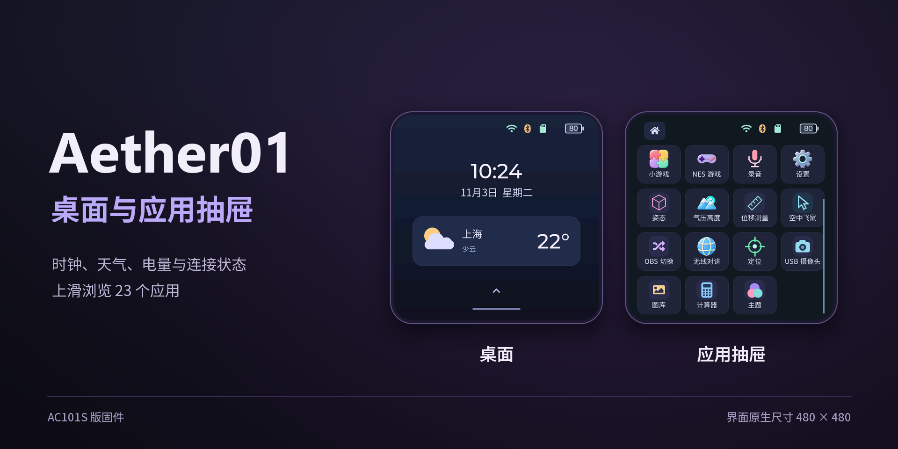
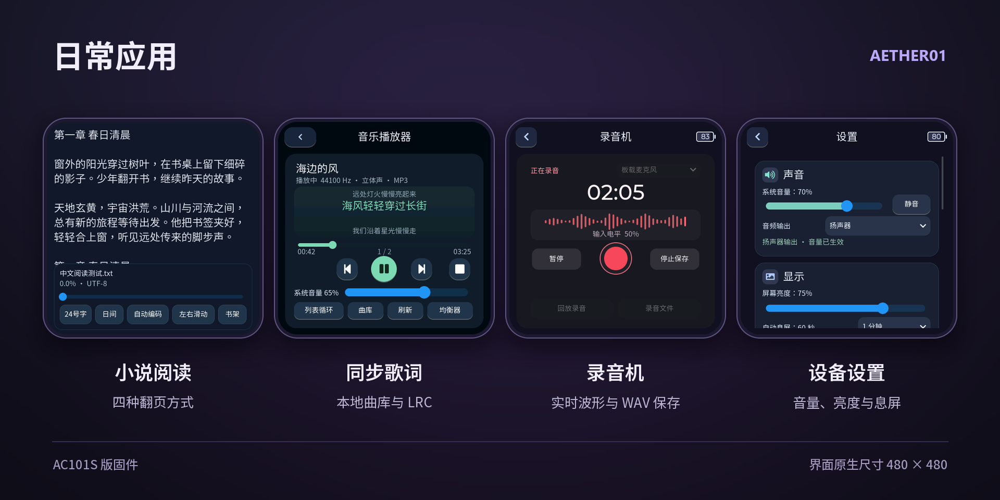
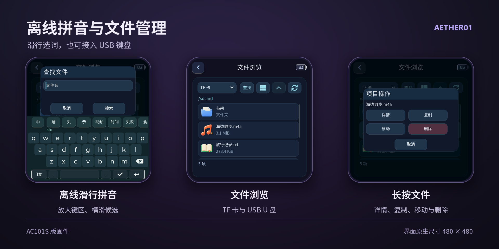
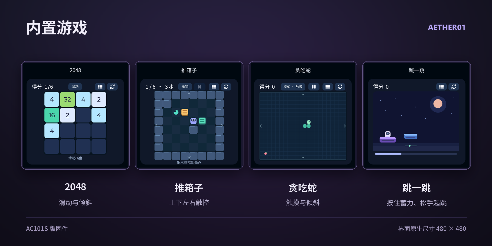

# Aether01 AC101S firmware

This standalone firmware demo targets the AC101S edition of Aether01, a handheld ESP32-S31 device with 64 MiB flash, 32 MiB PSRAM, a 480 × 480 AMOLED touchscreen, and TF storage. It uses ESP-IDF 6.1 and LVGL 9.5. Device coverage is still developing and the demo may contain bugs.

[Download firmware](https://github.com/DT-DT001/Aether01-AC101S-/releases/latest) · [中文说明](README.md) · [AC101S hardware](https://github.com/DT-DT001/Aether01-Hardware-AC101S) · [I/O and power map](docs/hardware/io-power-map.md)

## Interface previews









The 480 × 480 previews use the current firmware's LVGL interface with demo content.

Swipe up from the desktop to open the app drawer. Returning to the drawer restores its scroll position. The drawer's Home button or a two-second hold of the physical user button opens the desktop.

The firmware includes music playback with a live five-band EQ, video, recording, a TXT reader, NES emulation, USB OTG, Wi-Fi, Bluetooth controls, and ESP-NOW push-to-talk. Everyday tools include alarms, notes, a calendar, and weather. 2048 supports swipe and tilt controls. Sokoban and Snake respond to directional touch regions, and Snake also supports tilt.

Music playback supports synchronized LRC lyrics and remembers playback position. The recorder shows a live waveform and has its own recording list. The offline Pinyin keyboard supports glide typing and an optional vocabulary extension. Long-press a file to see its details, copy it, move it, or delete it.

Build from this checkout using an ESP-IDF 6.1 environment with ESP32-S31 support.

```sh
idf.py --preview set-target esp32s31
idf.py --preview build
```

The AC101S application image is `build/aether01_ac101s.bin`. Flash arguments are generated in `build/flash_args`.

Original firmware by DarkThunder is licensed under [Apache-2.0](LICENSE). Third-party licences apply to their respective components and assets. [NOTICE](NOTICE) · [Third-party notices](THIRD_PARTY_NOTICES.md)
