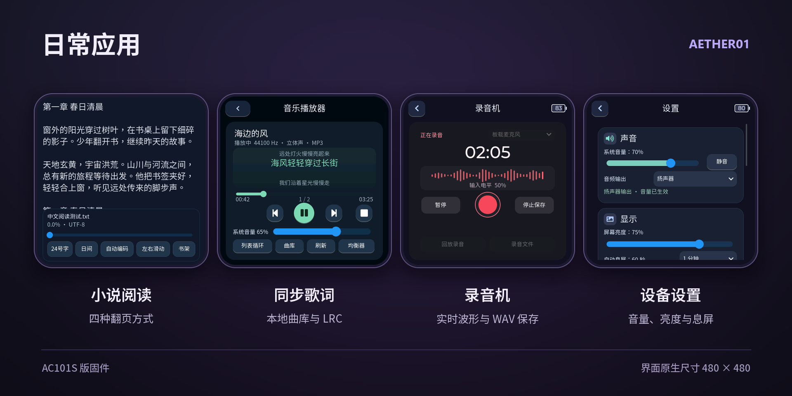
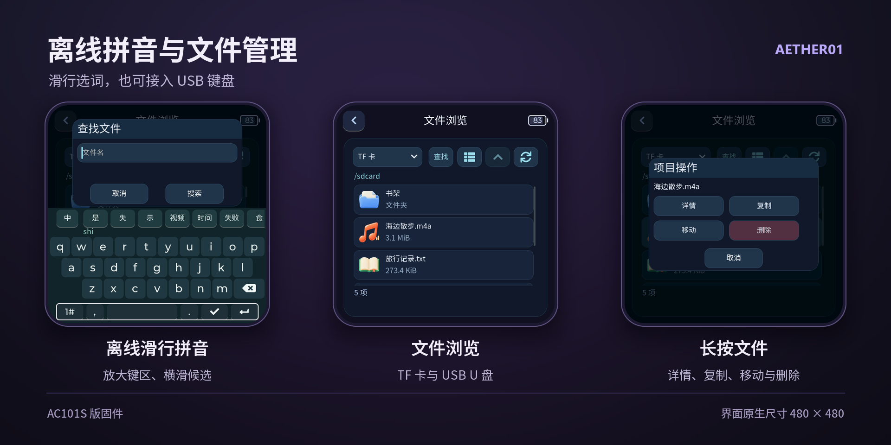
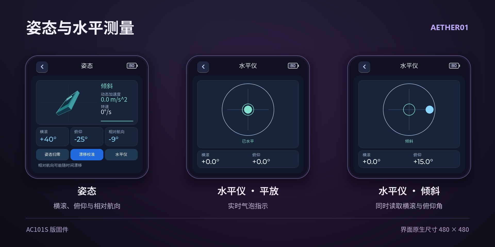
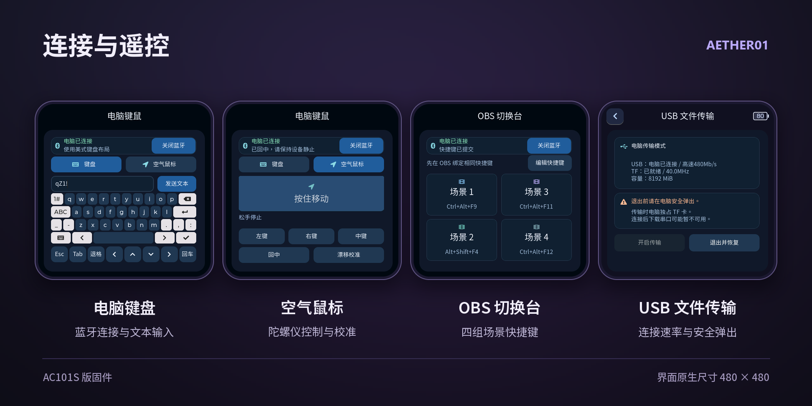

# 以太01（Aether01）AC101S 固件

以太01是一款基于 ESP32-S31 的开源掌上触屏设备。本仓库是 AC101S 音频硬件版的独立固件工程，使用 ESP-IDF 6.1 和 LVGL 9.5。

[下载 AC101S 固件](https://github.com/DT-DT001/Aether01-AC101S-/releases/latest) · [硬件设计文件](https://github.com/DT-DT001/Aether01-Hardware-AC101S) · [引脚与电源域](docs/hardware/io-power-map.zh_CN.md) · [English](README.en.md)

## 界面预览







<details>
<summary>实用工具与连接界面</summary>





</details>

图中的 480 × 480 界面预览由 LVGL 渲染，内容使用演示数据。

## 硬件与功能

| 模块 | 配置 |
| --- | --- |
| 主控与存储 | ESP32-S31、64 MiB Flash、32 MiB PSRAM、TF 卡 |
| 显示与触摸 | 480 × 480 AMOLED、CO5300AF、CST9220 |
| 音频 | AC101S、板载麦克风与扬声器、48 kHz / 16 位 I²S |
| 电源与传感器 | TG29-ESP、QMI8658A、DPS368、PCF85063，按实板装配使用 |

- 音乐播放器支持同名 LRC 歌词、播放进度记忆、拖动预览、五段实时 EQ、原声对比和音乐增益。录音机显示实时波形，将 WAV 保存到 TF 卡并提供独立的录音列表。视频播放器支持受限格式的全屏播放。[视频格式说明](docs/development/video-formats.zh_CN.md)
- TXT 阅读器支持中文分页、四种翻页手势、编码选择和书签。音乐曲库和文件列表支持连续滑动。NES 模拟器支持 USB 键盘、通用 HID 手柄、键位设置和电池 SRAM 存档。
- USB 支持 TF 卡虚拟 U 盘、USB OTG、标准 HID 以及相应的 USB 存储和音频设备。TF 卡支持 FAT32 和 exFAT。
- 无线功能包括 Wi-Fi、蓝牙音频与键鼠、空中飞鼠及电脑快捷键、可改名的 OBS 场景和 ESP-NOW 按键对讲。
- 按电源键或超时息屏时，前台应用暂停，正在播放的音乐继续。再次按电源键恢复原页面。
- 桌面显示时钟、天气和设备状态，上滑打开应用列表。从应用返回列表时会恢复滚动位置，列表左上角的 Home 或长按实体用户键 2 秒可回桌面。
- 日常工具包括闹钟、日历、记事本和天气。离线拼音提供中文输入和候选词选择。接入 USB 键盘时自动收起软键盘。[扩展词库安装说明](docs/development/pinyin-extension.md)
- 文件浏览支持按名称查找，长按可查看详情、复制、移动或删除。图库直接汇总可识别的图片。传感器工具提供气压、姿态和短程位移估算，空中鼠标的静置校准可保存至 NVS。
- 内置 2048、推箱子、贪吃蛇和跳一跳。2048 可切换滑动或倾斜。推箱子和贪吃蛇可点游戏区域的四个方向，贪吃蛇也支持倾斜转向。

- **卫星定位**可接 VG7669T160N0MA，显示真实卫星天空图、信号强度、经纬度/海拔/速度与PPS。开启时优先验证并使用现有USB输入；仅电池供电时才申请免CC OTG的5V输出。离页停止，具体接线及注意事项见[定位功能说明](docs/development/gps.zh_CN.md)。

## 构建

激活支持 `esp32s31` 目标的 ESP-IDF 6.1 环境后，在本仓库目录运行以下命令。组件管理器按 `dependencies.lock` 恢复依赖。

```sh
idf.py --preview set-target esp32s31
idf.py --preview build
```

固件应用镜像为 `build/aether01_ac101s.bin`，完整烧录参数见 `build/flash_args`。应用源码位于 `main/`，板载音频驱动位于 `components/ac101s_audio/`。[主机回归测试说明](tests/README.md)

## 许可证

DarkThunder 的原创固件代码采用 [Apache-2.0](LICENSE)。第三方库和字体适用各自的许可与署名。[NOTICE](NOTICE) · [第三方资料说明](THIRD_PARTY_NOTICES.md)
